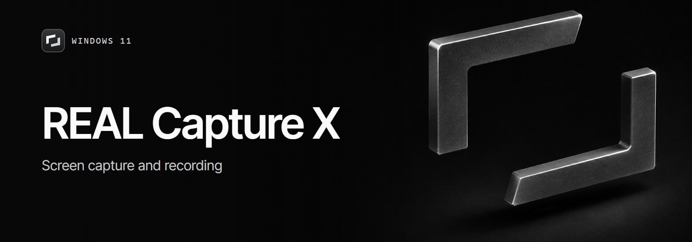
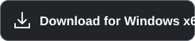
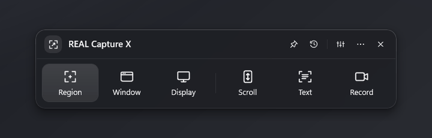
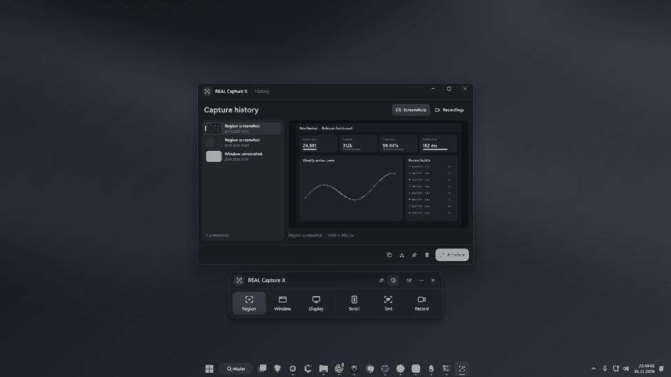
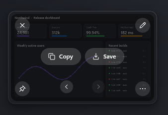
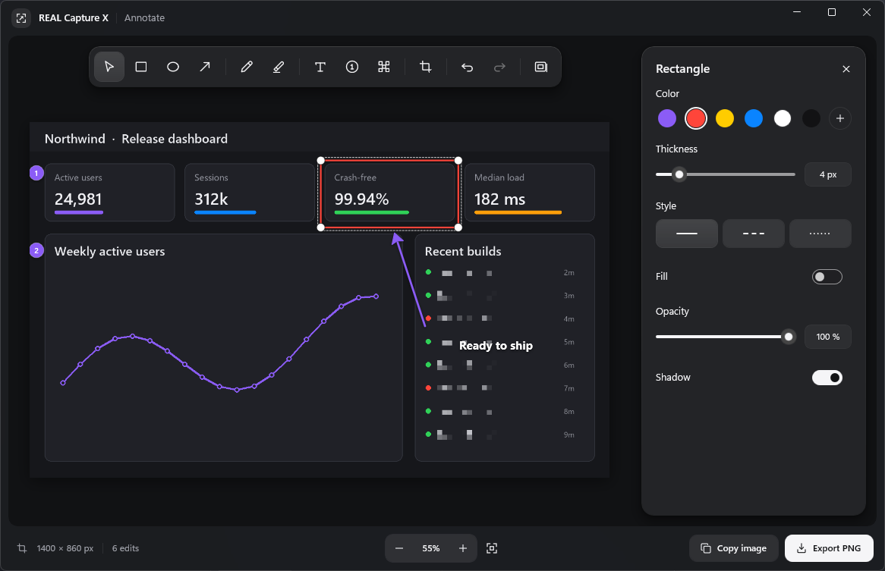
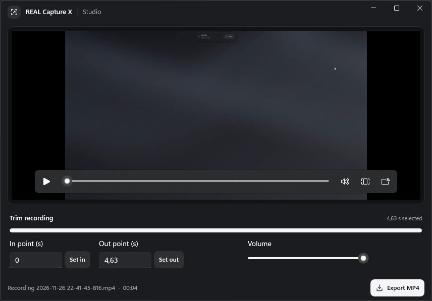
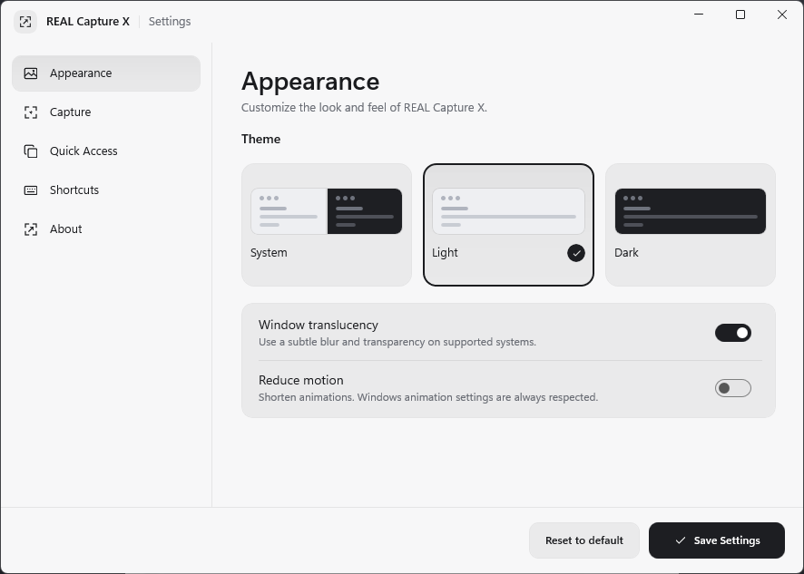
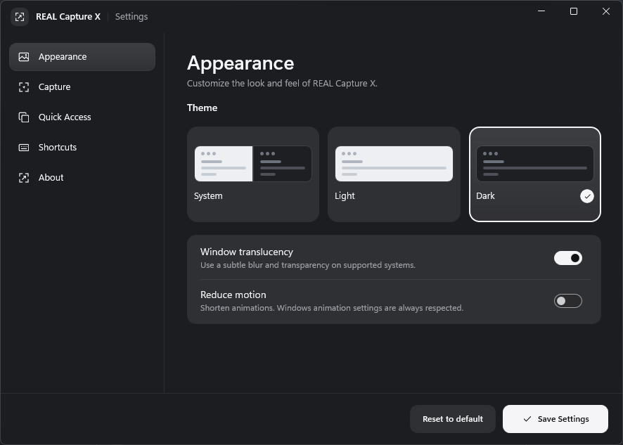

<h1></h1>

[](https://github.com/Trbex/capture-x/releases/latest)
[](https://github.com/Trbex/capture-x/actions/workflows/build.yml)

Press **Ctrl + Shift + 1** and draw a rectangle. Your screenshot appears in a card at the edge of the screen, ready to copy, pin or annotate. For a walkthrough, record a region and trim the clip in Studio.

[](https://github.com/Trbex/capture-x/releases/latest)

[Installation](#installation) · [Keyboard shortcuts](#keyboard-shortcuts) · [Changelog](CHANGELOG.md)

## Capture

The floating toolbar gives you six starting points. Capture a region, a window, or the display under your pointer. Scroll stitches a series of overlapping views into one image. Text runs English or Czech OCR locally. Record opens the controls for a region or an entire display.

<p align="center"></p>

**Quick Access** keeps the last capture within reach. Hover over the preview to copy or save the PNG. Open the card to annotate, or pin a reference above your work. History keeps screenshots and recordings in separate lists.

<details>
<summary>See region selection and the Quick Access card</summary>





</details>

## Annotate

Draw an arrow to a value, number the steps in a screenshot, or cover a name with a solid redaction. Select a mark to move it or adjust its properties. Add padding and a background for a presentation, then copy the finished image or export a PNG.



[Watch an annotation being drawn](docs/assets/editor-annotate.gif)

## Record and trim

Choose a region or display and start recording. The setup panel offers pointer, audio, webcam and click-zoom controls. While recording, the panel collapses to a timer and a Stop button. Studio opens the finished MP4 so you can set the in and out points, adjust volume and export a shorter clip.



[Recording setup](docs/assets/record-setup.png) · [Recording controls in motion](docs/assets/record-capsule.gif) · [Device testing and known limits](PROGRESS.md)

## Installation

1. Open the **[latest release](https://github.com/Trbex/capture-x/releases/latest)** and download the asset ending in `win-x64.zip`.
2. Extract the entire ZIP into a folder you want to keep.
3. Launch `RealCaptureX.exe` from that folder. Keep the adjacent DLLs, `RealCaptureX.pri` and `Assets` together.

The portable build runs on **Windows 11 x64** (declared minimum build 22000) and includes the .NET and Windows App SDK runtimes. Captures, recordings and preferences are stored in `%LOCALAPPDATA%\REAL Capture X`. To check a download, compare its PowerShell `Get-FileHash` SHA-256 result with the release’s `.sha256` file.

Choose **Settings → Appearance** to follow Windows or select a theme. You can also reduce motion and turn off translucency.

<details>
<summary>Compare the light and dark themes</summary>

| Light | Dark |
| --- | --- |
|  |  |

</details>

## Keyboard shortcuts

| Default shortcut | Action |
| --- | --- |
| `Ctrl + Shift + 1` | Select a region on the display under the pointer |
| `Ctrl + Shift + 2` | Pick a window |
| `Ctrl + Shift + 3` | Capture the display under the pointer |
| `Ctrl + Shift + 4` | Show the capture toolbar |
| `Ctrl + Shift + 5` | Bring back Quick Access |
| `Shift` while dragging | Constrain a region to a square |
| `Esc` | Cancel a selection |

Reassign the five global shortcuts in **Settings → Shortcuts**.

## Build from source

On Windows 11 x64 with the **.NET 10 SDK**, run these commands from the repository root.

```powershell
dotnet run --project RealCaptureX.csproj
```

To build the same self-contained layout used for releases, run the following command and launch `RealCaptureX.exe` from the output directory.

```powershell
dotnet publish RealCaptureX.csproj -c Release -r win-x64 --self-contained -o artifacts/RealCaptureX
```

## Roadmap

- Test selection and preview placement across monitors with different scaling factors and on HDR displays.
- Exercise longer recordings with physical microphones, system audio and webcam inputs.
- Explore automatic scrolling and improve stitching on pages with fixed headers.

The [implementation and verification notes](PROGRESS.md) track these items alongside the results available today.

## Project

OpenAI Codex contributed to the original application and the 0.2.0 redesign. Claude developed the glass surfaces and motion system, captured the product demos and fixed the two regressions in 0.2.1. [OpenAI Codex on GitHub](https://github.com/codex)

[Contributing](CONTRIBUTING.md) · [Security reporting](SECURITY.md) · [Third-party notices](THIRD-PARTY-NOTICES.md)
